## Herramientas de IA y su uso
- **Modelo / Plataforma**: Google Gemini (Asistente de Inteligencia Artificial Generativa)

El desarrollo del sistema se llevó a cabo utilizando inteligencia artificial (Google Gemini) como herramienta de apoyo y asistencia técnica. La IA se empleó para estructurar el código base en Python/Flask, diseñar esquemas de bases de datos relacionales, refactorizar reglas de negocio de gestión de hardware (HAM) y redactar scripts de automatización local en PowerShell. Todas las soluciones generadas fueron supervisadas, probadas e integradas de forma crítica para asegurar su correcto funcionamiento.

Las interacciones con la IA se dividieron en cuatro etapas principales:

- **Fase 1: Diseño y Estructura Base (MVP)**
    - _Uso de IA:_ Generación de la estructura inicial de carpetas, esquemas relacionales en SQLite (`schema.sql`), script de poblamiento de datos ficticios (`init_db.py`), lógica de rutas en el backend (`app.py`) y plantillas visuales con Tailwind CSS vía CDN (`base.html`, `index.html`, `asset_detail.html`).
- **Fase 2: Expansión de Funcionalidades**    
    - _Uso de IA:_ Solicitud de código para implementar alertas de stock mínimo configurables por categoría, un endpoint para exportación de reportes a formato CSV/Excel y la integración de etiquetas dinámicas con códigos QR mediante APIs externas.
- **Fase 3: Correción de la lógica del Negocio (HAM)**
    - _Uso de IA:_ Asistencia en la corrección de inconsistencias de ciclo de vida de los activos, aplicando validaciones estrictas de fechas de garantía y matrices de asignación automática de custodios según el estado del equipo (_Disponible_, _Asignado_, _En Mantenimiento_, _En Garantía_, _Dado de Baja_).
- **Fase 4: Experiencia de Usuario y Despliegue Local**   
    - _Uso de IA:_ Creación de un script de automatización en PowerShell (`iniciar_techdesk.ps1`) para verificar dependencias (como la instalación de Flask), inicializar la base de datos de manera silenciosa y levantar el servidor web local con un retardo sincronizado para usuarios no técnicos.

## Control Humano

- Todo el código generado por la inteligencia artificial fue **probado e integrado de forma manual**.
- Se realizaron pruebas y validaciones de flujo para garantizar que las reglas de negocio de gestión de activos (HAM) funcionaran de manera coherente y sin fugas de lógica en la base de datos SQLite.

## Capturas de prompts

#### Prompt 1:
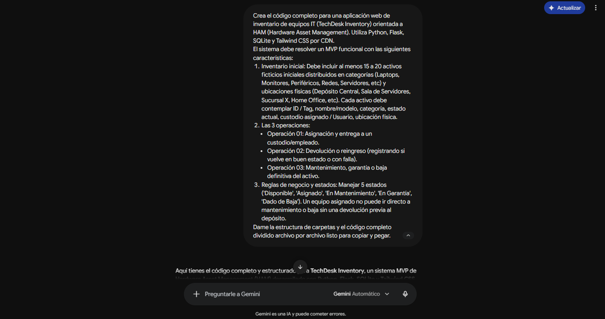

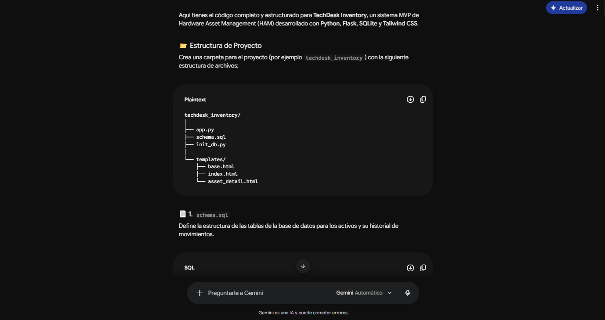

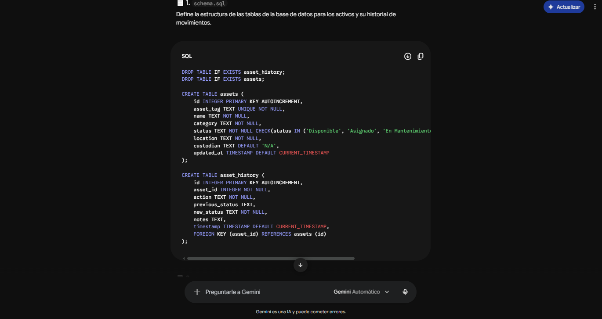

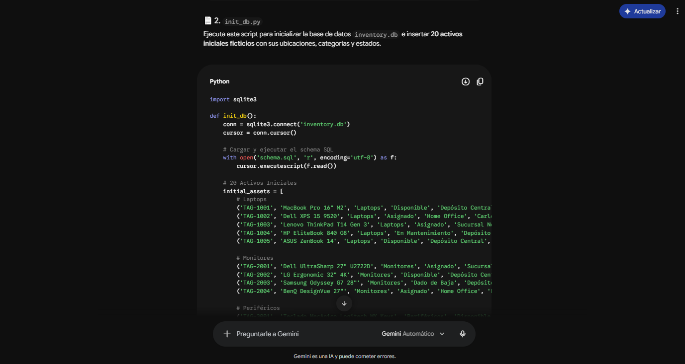

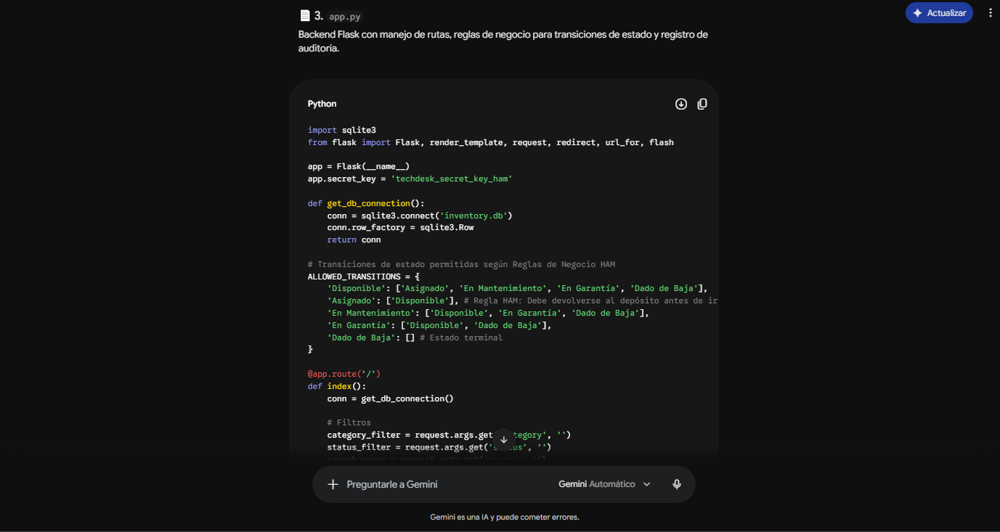

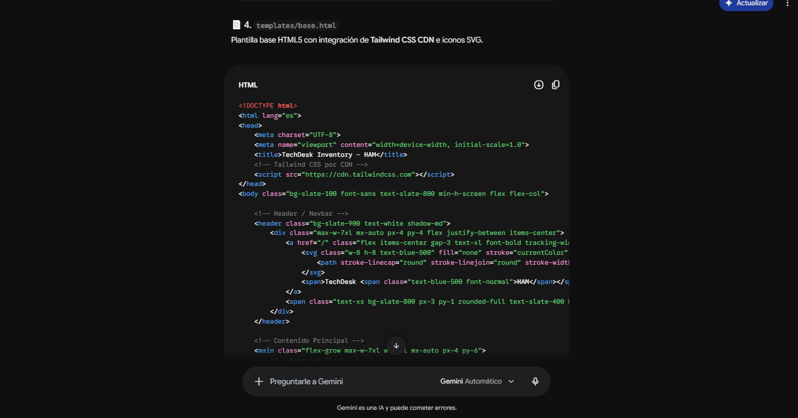

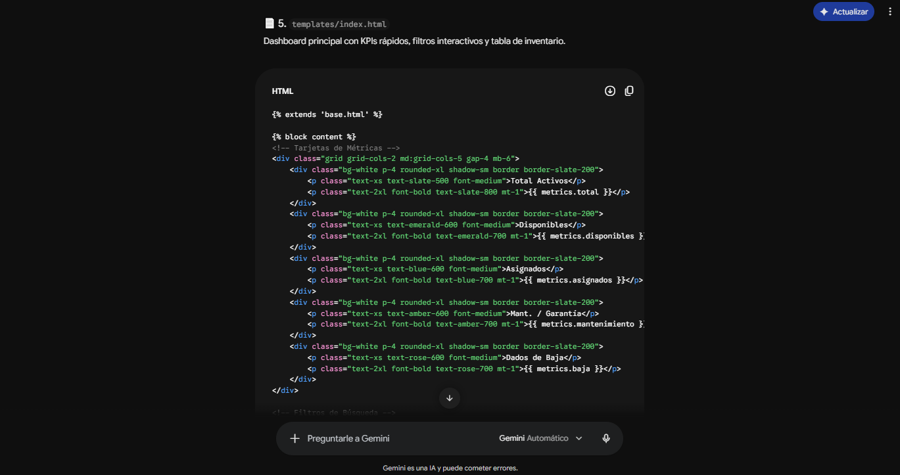

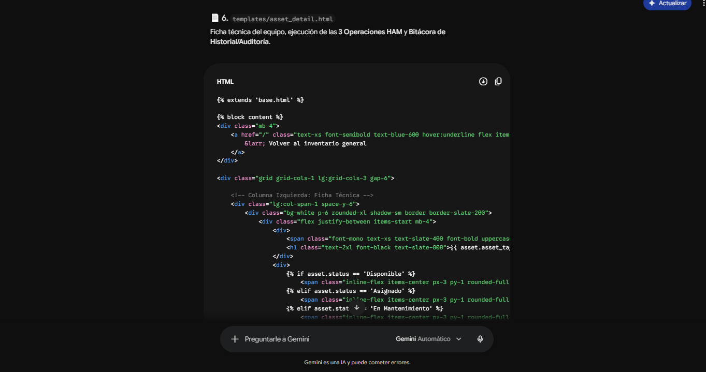

#### Prompt 2:
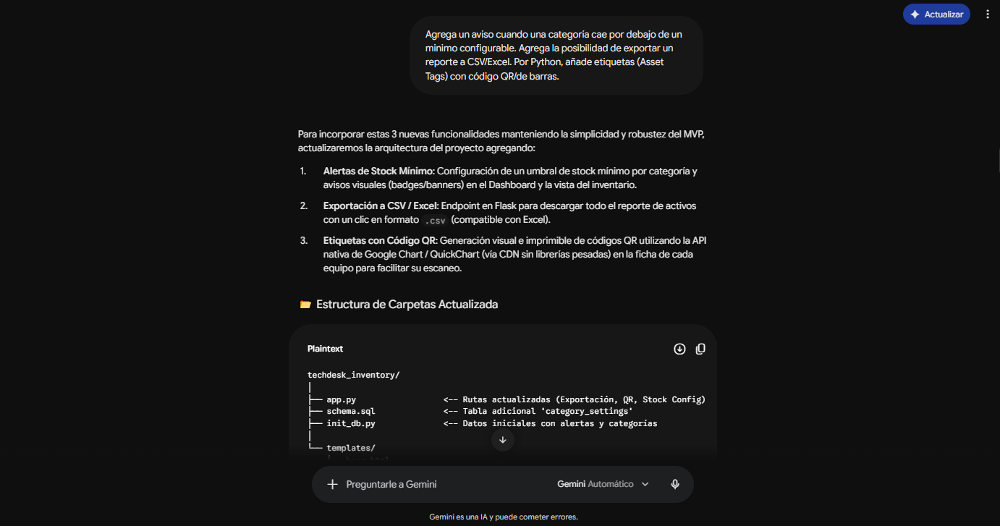

#### Prompt 3:
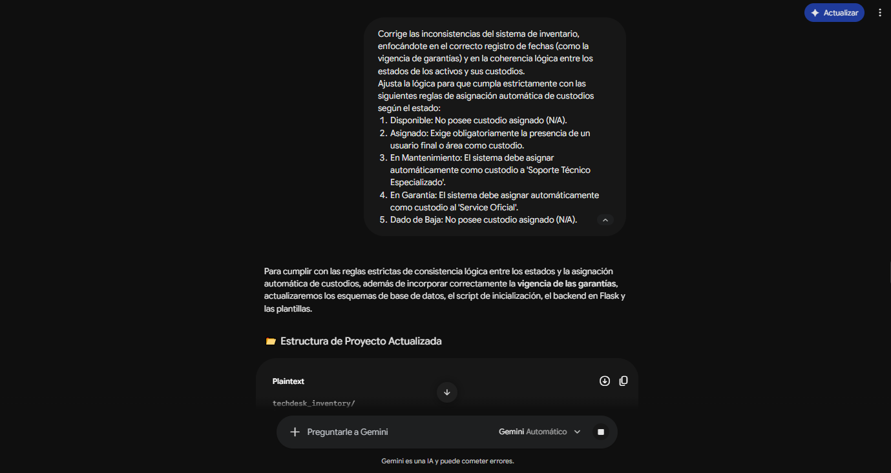

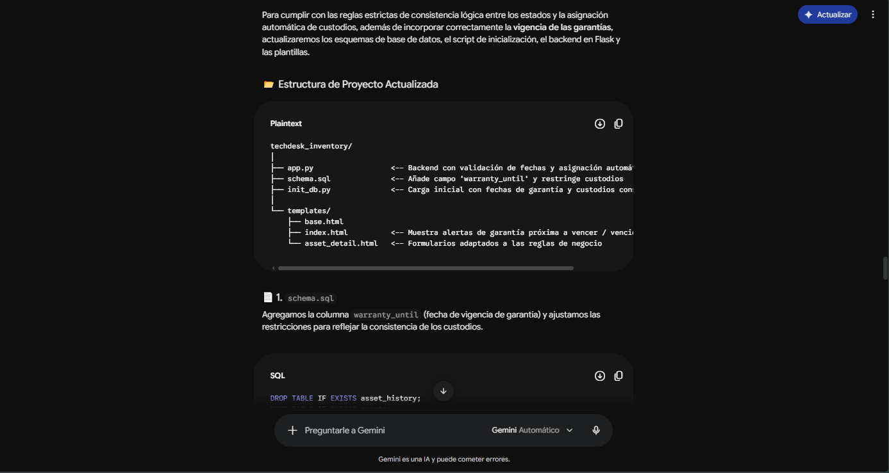